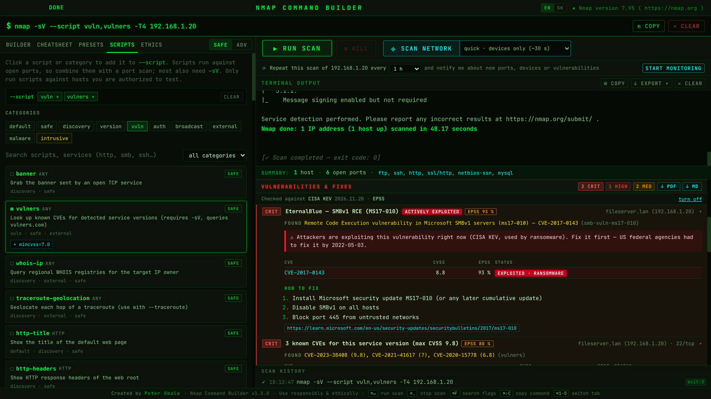

# Nmap Command Builder

A desktop cybersecurity tool for building, executing, and analysing **Nmap scans** through a graphical interface — no command-line experience required. Interface in **English and Slovak**.

Built with **Electron + React** and designed for system administrators, cybersecurity students, and network engineers.

---

# Table of Contents

- [Screenshot](#screenshot)
- [Quick Start](#quick-start)
- [Features](#features)
- [Why This Project Exists](#why-this-project-exists)
- [Requirements](#requirements)
- [Installation](#installation)
- [Usage](#usage)
- [Root Privileges](#root-privileges)
- [Testing](#testing)
- [Production Build](#production-build)
- [Security Model](#security-model)
- [Dependency Security Notes](#dependency-security-notes)
- [Responsible Use](#responsible-use)
- [Changelog](CHANGELOG.md)
- [Roadmap](#roadmap)
- [Author](#author)
- [License](#license)

---

# Screenshot

---

# Quick Start

Clone the repository and run the development version.

    git clone https://github.com/peterfromslovakia/nmap-command-builder.git
    cd nmap-command-builder
    npm install
    npm run dev

The application will start as an Electron desktop app with the Nmap command builder interface.

---

# Features

## Network Scan with One Button

- **⌖ SCAN NETWORK** finds all active devices in your network (or any range you enter) — *quick* (devices only, ~1–2 min for a /24) or *detailed* (open ports and services)
- **Network devices** table: device type (router, firewall, printer, NAS, camera, Windows / Apple / Linux computer, phone, TV, IoT, Wi-Fi AP / switch), IP, name, operating system, **MAC address and vendor** (also without root, from the system ARP table; private / randomised phone MACs are marked), open ports and latency
- Filter by type, search, sort, export to CSV (Excel) and **SCAN ›** any device with one click
- **Network map**: Internet → your router (the real default gateway of this computer) → devices grouped by type, each coloured by risk (critical / high / medium vulnerability, risky open ports such as SMB, RDP or Telnet, nothing found); actively exploited (CISA KEV) devices are marked, your own computer is marked *YOU*, *only devices at risk* filter, click a device for MAC, OS, ports and vulnerabilities
- Works without root (TCP connect ping on common ports finds devices that ignore ping)

## Live Vulnerability Intelligence (no registration)

- Every CVE found by `vulners` / `vuln` scripts is checked against **CISA KEV** (vulnerabilities attackers are exploiting right now, incl. ransomware use), **FIRST EPSS** (probability of exploitation in the next 30 days) and **NIST NVD** (CVSS vector, CWE, description)
- Actively exploited findings are marked **ACTIVELY EXPLOITED**, raised to at least *High* and listed first
- No account or API key; only CVE numbers are sent (never IP addresses, host names or scan output); results are cached so the app also works offline; can be turned off

## Monitoring

- **Repeat a scan every 15 min / 1 h / 6 h / 24 h** and get a **system notification** when a new device, open port or vulnerability appears (compared with the previous scan of the same target)
- Status bar with the next run, last result, *run now* and *stop*; the schedule survives an app restart and runs only while the app is open
- Optional **automatic PDF report** into a folder you choose — after the first run and whenever something changes (`nmap-monitor-<target>-<date>_<time>.pdf`)

## Command Builder

- **English / Slovak** interface (EN | SK switch in the header, remembered; starts in Slovak on Slovak / Czech systems)
- Visual flag selector organised into collapsible categories
- Live command preview
- Safe / Advanced mode toggle
- 23 built-in scan presets (TLS audit, SMB security check, CVE lookup, database exposure, web vulnerability scan, …), each labelled **LOW / NOISY / INTRUSIVE** with an explanation of the risk; the most dangerous ones (brute-force, exploit/dos scripts) appear only in Advanced mode
- Automatic local network detection pre-fills the target (the whole network up to /22, e.g. `10.0.0.0/22` = 10.0.0.1 – 10.0.3.254; larger networks start with the /24 around your address) and refreshes when the window regains focus
- **My presets**: save your own flag combinations (optionally with the target) and reuse them with one click; **export / import** them as a JSON file to share with colleagues or back up (imported presets are checked — unknown flags are dropped)
- Searchable Nmap cheatsheet
- NSE script library (SCRIPTS tab): 71 curated scripts and all script categories with descriptions, risk level and one-click `--script` / `--script-args` (brute / exploit / dos only in Advanced mode)

## Scan Execution

- Runs Nmap via `child_process.spawn`
- Live streaming terminal output
- Kill button for long scans
- Export results as `.txt`, `.json`, `.csv`
- **Penetration-test style reports** as PDF or Markdown, in **English or Slovak**: cover page and document control (tester, organisation, client, authorisation reference, classification), table of contents, executive summary with overall risk and priority actions, scope and methodology (derived from the actual command), risk rating with remediation timeframes, findings **F-01…** with affected asset, CVSS vector, EPSS, CWE, CISA KEV status, impact, NIST description and fix, asset inventory and **network map** (appendix) from the network scan, changes since the previous scan, hardening recommendations, sign-off table and raw output
- Scan history with quick reload
- Interface scales automatically with the window — from small laptop screens (1100×700) up to 1440p and 4K monitors

## Post-Scan Intelligence

- **Changes since previous scan**: compares each scan with the previous scan of the same target — new / disappeared hosts, newly opened / closed ports, version changes, new / fixed vulnerabilities (results are stored locally in the app, max. 30 scans)
- **Vulnerabilities & Fixes** panel: detects known issues in NSE script output (EternalBlue, Heartbleed, anonymous FTP, SMBv1, open relay, weak TLS, CVEs from `vulners`, …) and shows step-by-step remediation
- "How to fix" hardening steps for every risky open port in Security Intel
- Open Ports Panel with risk classification
- Host Info Panel (IP, hostname, MAC, vendor)
- Security Intel Panel
- Follow-up scan suggestions

## Safety & Awareness

- ROOT badge for privileged scans, and a notice when the app runs without root explaining which selected flags need it
- IDS/IPS warning for stealth techniques
- Built-in ethics and legal notice panel

---

# Why This Project Exists

Many powerful cybersecurity tools require deep command-line knowledge.

This project aims to make **Nmap accessible through a graphical interface while still exposing the real commands being executed**.

It helps:

- system administrators
- cybersecurity students
- penetration testers
- network engineers

learn and use Nmap effectively without memorising hundreds of flags.

---

# Requirements

| Requirement | Version |
|---|---|
| Node.js | 18+ |
| Nmap | 7.x or newer |
| OS | macOS · Windows · Linux |
| Runtime | Electron |

The app scans **IPv4** networks and hosts (addresses, CIDR ranges, address ranges, host names). IPv6 scanning is intentionally not included: an IPv6 network (/64) has 18 quintillion addresses and cannot be swept, and devices on home and office networks are normally reachable over IPv4 as well.

---

# Installation

## Option 1 — Download prebuilt release (recommended)

Download the latest release from:

https://github.com/peterfromslovakia/nmap-command-builder/releases

Available builds:

- macOS Apple Silicon (M1–M5) → `…-arm64.dmg`
- macOS Intel → `…-x64.dmg`
- Windows → `…Setup-….exe`
- Linux → `….AppImage`

### Updates

Every release is built for all platforms above. The app checks for a new version on start (at most every 12 hours) and shows a banner with a download button for your system; *Help → Check for Updates…* checks on demand. Download the new installer and install it over the old version — your saved presets, scans and settings are kept. The check only reads the public GitHub releases page and can be turned off in the banner (*don't check automatically*).

No Node.js installation required.

### macOS: first launch

The app is not signed with a paid Apple Developer ID, so macOS blocks it on first launch:

1. Open the `.dmg` and drag **Nmap Command Builder** to **Applications**.
2. Open the app — macOS shows *"cannot be opened because Apple cannot check it for malicious software"*. Click **Done**.
3. Open **System Settings → Privacy & Security**, scroll down and click **Open Anyway** next to *Nmap Command Builder*, then confirm.

Alternatively, from Terminal:

    xattr -cr "/Applications/Nmap Command Builder.app"

If version **1.1.0** reports *"is damaged and can't be opened"*, run:

    codesign --force --deep --sign - "/Applications/Nmap Command Builder.app"
    xattr -cr "/Applications/Nmap Command Builder.app"

(fixed in 1.2.0 — builds are now ad-hoc signed)

---

## Option 2 — Run from source

Clone the repository:

    git clone https://github.com/peterfromslovakia/nmap-command-builder.git
    cd nmap-command-builder

Install dependencies:

    npm install

Install Nmap if needed.

### macOS (Homebrew)

    brew install nmap

### Debian / Ubuntu

    sudo apt install nmap

---

# Usage

Run development mode:

    npm run dev

This launches:

- React frontend
- Electron desktop window
- Nmap command builder interface

You can visually build commands and execute scans directly from the application.

## Keyboard shortcuts

| macOS | Windows / Linux | Action |
|---|---|---|
| ⌘ ↵ | Ctrl + Enter | Run scan |
| ⌘ . | Ctrl + . | Stop running scan |
| ⌘ F | Ctrl + F | Search flags |
| ⌘ ⇧ C | Ctrl + Shift + C | Copy command |
| ⌘ 1 – 5 | Ctrl + 1 – 5 | Switch tab (Builder, Cheatsheet, Presets, Scripts, Ethics) |

The **Help** menu links to the Nmap reference guide, NSE script documentation, the latest release and issue reporting. Window size and position are remembered between launches.

## Where data is stored

The app needs no administrator rights or special permissions for its data — it uses the standard per-user application folder that every desktop app gets:

| System | Folder |
|---|---|
| macOS | `~/Library/Application Support/Nmap Command Builder` |
| Windows | `%APPDATA%\Nmap Command Builder` |
| Linux | `~/.config/Nmap Command Builder` |

Typical size is 5–30 MB (mostly Electron's own cache; the vulnerability database cache is under 1 MB). PDF reports are rendered through a temporary file that is deleted immediately. *Help → Open Data Folder* shows the folder, *Help → Delete All Saved Data…* removes everything after a confirmation (exported reports are not touched).

Saved scan results (for the comparison), your presets, the monitoring schedule, the interface language and report details (tester name, organisation, …) are stored only locally in the app's data folder. The app makes these network requests on its own, all without an account or API key:

| Service | When | What is sent |
|---|---|---|
| GitHub releases API | update check (max. every 12 h, can be turned off) | nothing but the request |
| CISA KEV catalogue | after a scan with CVEs (max. once a day) | nothing — the whole public list is downloaded |
| FIRST EPSS API | after a scan with CVEs | CVE numbers only |
| NIST NVD API | after a scan with CVEs (details for up to 25 CVEs) | CVE numbers only |

IP addresses, host names and scan output never leave your computer. Turn the vulnerability lookups off with *turn off* in the Vulnerabilities panel. Untick *Remember these details* in the report dialog to keep only the report language. Use *forget saved scans* in the comparison panel or ✕ next to a preset to delete them.

---

# Root Privileges

Some Nmap scan techniques require **root privileges (administrator rights)**.

Examples include:

- SYN scan (`-sS`)
- OS detection (`-O`)
- UDP scan (`-sU`)
- advanced stealth techniques

When the application is launched normally (for example from Finder, Launchpad, or a desktop icon), it runs with standard user permissions. The command is **never changed** — instead, a notice above the terminal shows which selected flags need root and what Nmap will do without it.

Verified with Nmap 7.99 without root:

| Flags | Without root |
|---|---|
| `-sS` `-sU` `-sA` `-sN` `-sF` `-sX` `-sI` `-O` `-f` `--mtu` `-D` `-S` `-PU` `--traceroute` | Nmap stops: *"requires root privileges. QUITTING!"* |
| `--spoof-mac` `--data-length` `--badsum` | the scan runs, but Nmap ignores the option |
| `-A` | **works** — version detection and default scripts run; only the OS detection and traceroute parts are skipped |
| `-sT` `-sV` `-sC` `--script` `-PS` `-PA` `-p` `-T*` … | work normally |

Tip: `-sT` (TCP connect scan) finds the same open ports as `-sS` without root, and `-sV` often reports the operating system in the *Service Info* line.

### Run as administrator (no Terminal needed)

When the selected flags need root, the notice shows **🔒 RUN AS ADMINISTRATOR**. The same command then runs with administrator rights:

- **macOS** — the system asks for your account password (`sudo` with a native password dialog)
- **Linux** — a graphical password dialog (`sudo` with zenity / kdialog, otherwise `pkexec` / polkit)
- The password goes straight to the system — the app never sees or stores it
- For safety, administrator runs may not read or write files: `-oN`, `-oX`, `-oG`, `-iL`, script files and paths in `--script-args` are refused (as root they could overwrite any file). Export the results from the app instead
- Monitoring is not offered for administrator scans (it would ask for the password on every run)

Alternatively, launch the whole application from Terminal with root privileges:

    sudo "/Applications/Nmap Command Builder.app/Contents/MacOS/Nmap Command Builder"

On Windows, Nmap uses Npcap, so raw scans work without running the app as administrator.

---

# Testing

    npm test            # renderer: validators, NSE selection, findings, reports, presets, user presets, shortcuts, scan diff, root rules, config
    npm run test:main   # main process: network detection, argument whitelist, window state, menu
    npm run lint        # ESLint, no warnings allowed (also runs in CI)

The preset tests check that every preset only uses known flags, produces a command the main-process whitelist accepts, and is labelled at least as risky as the NSE scripts it runs (intrusive → NOISY, `vuln` → INTRUSIVE, brute / exploit / dos → INTRUSIVE and Advanced-only).

Regression tests also guard the build and layout: the root-flag list matches the flag definitions, the release workflow does not create duplicate assets, the macOS build is ad-hoc signed, the CHANGELOG has a section for the current version and the footer shows the `package.json` version.

---

# Production Build

Create optimized build:

    npm run build

Create distributable application:

    npm run dist

This generates installers such as:

- macOS → `.dmg`
- Windows → `.exe`
- Linux → `.AppImage`

inside the `dist` directory.

---

# Security Model

Security design decisions used in the application:

- `contextIsolation` enabled
- `nodeIntegration` disabled
- Nmap execution only from Electron **main process**
- user input validated before execution
- `spawn` used instead of `exec`
- no shell interpolation allowed
- renderer sandbox enabled (`sandbox: true`)
- IPC calls accepted only from the app window
- nmap flags are checked against a whitelist in the main process
- `--script` accepts script names and categories only, not file paths
- navigation, new windows, webviews and permission requests are blocked
- exports limited to `.txt`, `.json`, `.csv`, `.md` and `.pdf`
- PDF reports are rendered in a hidden window with JavaScript disabled, a strict CSP (`default-src 'none'`) and all scan data HTML-escaped

These measures help prevent command injection and improve runtime security.

---

# Dependency Security Notes

Running `npm audit` may report vulnerabilities in development dependencies such as:

- `react-scripts`
- `webpack-dev-server`
- Electron build tooling
- packaging libraries

These warnings primarily affect the **development and build toolchain**, not the runtime behaviour of the packaged Electron application.

To maintain build stability, dependencies are updated cautiously rather than automatically applying breaking changes with:

    npm audit fix --force

---

# Responsible Use

Only scan networks and systems **you own or have explicit authorisation to test**.

Unauthorised port scanning may be illegal in many jurisdictions.

### Slovakia

Skenovanie sietí bez povolenia je v Slovenskej republike trestným činom podľa § 247 Trestného zákona.

Always follow responsible disclosure and legal guidelines when performing security testing.

---

# Roadmap

Future improvements planned:

- improved network topology visualisation
- import / export of user presets (share them between computers)
- scheduled re-scans with a notification when something changes

---

# Author

**Peter Obala**

Cybersecurity enthusiast · Network administrator

GitHub  
https://github.com/peterfromslovakia

---

# License

MIT License — see [LICENSE](LICENSE).
